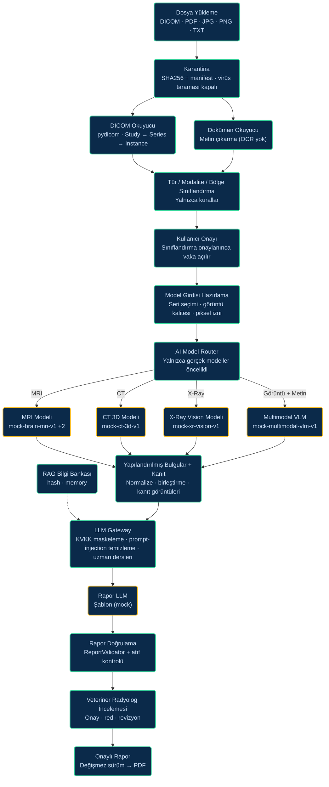

<!-- Bu dosya otomatik üretilir; elle düzenlemeyin.
     Kaynak: backend/app/services/architecture_status.py
     Yeniden üretmek için: cd backend && python scripts/generate_architecture_doc.py -->

# VetMind AI — Yapay Zekâ Akışı

Yüklemeden onaylı rapora kadar AI akışı. Diyagram koddan üretilir: analiz adımları `orchestration/progress.py` içindeki `PIPELINE_STAGES` listesinden, router dalları `Modality` listesinden, modeller kayıtlı model tablosundan gelir. Kod değişince GitHub Action bu dosyayı yeniden üretir.

Renkler **varsayılan kurulumu** gösterir (`.env` yok: mock LLM, mock görüntü modelleri, hash embedding). Çalışan sistemin canlı durumu admin panelinde **AI Mimarisi** sayfasındadır.

🟢 Gerçek / her zaman çalışan adım · 🟡 Mock (sahte çıktı) · 🟠 Yedeğe düştü · ⚪ Kapalı / yapılandırılmamış

## Kod karşılıkları

| Kutu | Kod |
|------|-----|
| Dosya Yükleme | `api/dicom.py`, `api/documents.py` |
| Karantina | `storage/quarantine.py`, `storage/malware_scan.py`, `ingest/filetype.py` |
| DICOM Okuyucu | `dicom/parser.py`, `dicom/validator.py`, `dicom/ingest.py` |
| Doküman Okuyucu | `ingest/documents.py` |
| Tür / Modalite / Bölge Sınıflandırma | `dicom/classifier.py`, `dicom/llm_classifier.py` |
| Kullanıcı Onayı | `services/dicom_service.py` |
| Model Girdisi Hazırlama | `models/model_input_builder.py`, `imaging/series_selection.py`, `imaging/quality.py`, `models/pixel_authorization.py` |
| AI Model Router | `routing/model_router.py`, `routing/scenario_policy.py`, `routing/execution_policy.py`, `routing/capabilities.py` |
| Router dalları (MRI, CT, X-Ray, Görüntü + Metin) | `models/mock_vision.py`, `models/local_torch.py`, `models/vlm_vision.py`, `models/http_vision.py` |
| Yapılandırılmış Bulgular + Kanıt | `models/normalizer.py`, `models/evidence_attach.py` |
| LLM Gateway | `llm/gateway.py`, `llm/privacy.py`, `llm/lessons.py` |
| RAG Bilgi Bankası | `rag/retriever.py`, `rag/relevance.py`, `rag/chroma_store.py`, `rag/ollama_embeddings.py` |
| Rapor LLM | `llm/factory.py`, `llm/chat_providers.py`, `llm/verifier.py` |
| Rapor Doğrulama | `validation/report_validator.py`, `llm/grounding.py` |
| Veteriner Radyolog İncelemesi | `services/workflow_service.py`, `services/report_versioning.py` |
| Onaylı Rapor | `services/pdf_report.py` |

Akışı yöneten: `orchestration/orchestrator.py` (`AIOrchestrator.run`).
