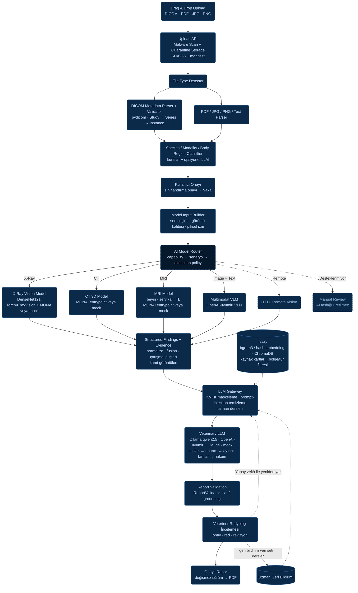

# VetMind AI — Yapay Zekâ Akışı

Yüklemeden onaylı rapora kadar kodda gerçekten çalışan AI akışı. Kesik çizgiler opsiyonel / yan girdileri gösterir.

## Kod karşılıkları

| Kutu | Kod |
|------|-----|
| Upload API / Quarantine | `api/dicom.py`, `api/documents.py`, `storage/quarantine.py`, `storage/malware_scan.py` |
| File Type Detector | `ingest/filetype.py` |
| DICOM Parser / Validator | `dicom/parser.py`, `dicom/validator.py`, `dicom/ingest.py` |
| Doküman Parser | `ingest/documents.py` |
| Classifier | `dicom/classifier.py`, `dicom/llm_classifier.py` |
| Model Input Builder | `models/model_input_builder.py`, `imaging/series_selection.py`, `imaging/quality.py`, `models/pixel_authorization.py` |
| AI Model Router | `routing/model_router.py`, `routing/scenario_policy.py`, `routing/execution_policy.py`, `routing/capabilities.py` |
| X-Ray / CT / MRI | `models/local_torch.py`, `models/entrypoints/{xray,ct,mri}_monai.py`, `models/mock_vision.py` |
| Multimodal VLM | `models/vlm_vision.py` |
| HTTP Remote Vision | `models/http_vision.py` |
| Structured Findings + Evidence | `models/normalizer.py`, `models/evidence_attach.py` |
| LLM Gateway | `llm/gateway.py`, `llm/privacy.py`, `llm/lessons.py` |
| RAG | `rag/retriever.py`, `rag/relevance.py`, `rag/chroma_store.py`, `rag/ollama_embeddings.py` |
| Veterinary LLM | `llm/factory.py`, `llm/chat_providers.py`, `llm/verifier.py` |
| Report Validation | `validation/report_validator.py`, `llm/grounding.py` |
| Akışı yöneten | `orchestration/orchestrator.py` (`AIOrchestrator.run`) |
