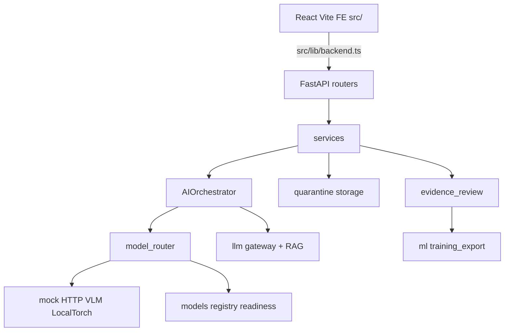

# VetMind AI — Architecture Map

**Verified against:** commit `e85dab3`  
**Primary narrative:** [ARCHITECTURE.md](../ARCHITECTURE.md) · AI detail: [ARCHITECTURE_AND_LLM.md](ARCHITECTURE_AND_LLM.md)

## System shape

Modular monolith. Composition root: `backend/app/container.py` (`AppContainer`).  
HTTP: thin FastAPI routers under `backend/app/api/` mounted from `backend/app/main.py` at `/api/v1/*`.

## Backend package map

| Package | Path | Role |
|---------|------|------|
| API | `backend/app/api/` | cases, dicom, analysis, reports, evidence, auth, rag, workflow, payments, messaging, notifications, settings, training_export, models |
| Services | `backend/app/services/` | case, dicom, report_versioning, PDF, payment, messaging, workflow, evidence_review |
| Orchestration | `backend/app/orchestration/` | `AIOrchestrator`, progress |
| Models | `backend/app/models/` | adapters, `registry.py`, `local_torch.py`, `weight_cache.py`, `entrypoints/*_monai.py` |
| LLM | `backend/app/llm/` | factory, gateway, grounding, structured output, chat providers |
| RAG | `backend/app/rag/` | retriever, embeddings, vector_store, `relevance.py` |
| DICOM | `backend/app/dicom/` | parse, validate, anonymize, classifier |
| Imaging | `backend/app/imaging/` | pixel_ops, display_png, geometry, VLM transform |
| Routing | `backend/app/routing/` | capabilities, execution/scenario policy |
| Auth | `backend/app/auth/` | JWT, API key, RBAC, tenancy, deps |
| Storage | `backend/app/storage/` | quarantine, encryption protocol boundary |
| ML export | `backend/app/ml/` | training_export, export_manifest |
| Evaluation | `backend/app/evaluation/` | classification, rag, llm eval bridges |
| Workers | `backend/app/workers/` | thread jobs, optional RQ / GPU worker sketch |
| Security | `backend/app/security/` | audit JSONL, retention helpers |

## Frontend map

| Area | Path |
|------|------|
| Routes / gates | `src/App.tsx`, role `Gate` |
| API client | `src/lib/backend.ts` |
| Radiologist | `src/pages/RadiologistWorkspace.tsx`, `src/components/DicomViewer.tsx`, `AIFindingsPanel.tsx`, `ReportDocumentEditor.tsx`, `ProvenanceBanner.tsx` |
| Clinical flow | `DicomUpload`, `Processing`, `CaseList`, `CaseDetail`, `ReviewQueue`, `ApprovedReport` |
| Admin / ops | `Dashboard`, `Modules`, `SystemStatus`, `AdminUsers`, `ModelPerformance` |
| i18n | `src/i18n/en.json`, `tr.json` |

## Critical runtime paths

### Demo clinical path (typical)

1. Upload → `storage/quarantine.py`  
2. Classify/confirm → `dicom_service` / cases API  
3. Analyze → `AIOrchestrator` (Vision → fusion → LLM+RAG → validator)  
4. Expert review → reports + evidence  
5. Approve → immutable version + PDF  

### Training-adjacent path (Goal A)

1. Expert verify evidence (`api/evidence.py`)  
2. `POST /api/v1/training/export` (`api/training_export.py`)  
3. Patient split (`ml/evaluation/patient_split.py`)  
4. Offline train script (`ml/training/`) → checkpoint for LocalTorch **experimental** only  

### Production model routing rule

- Cloud Gemini VLM/LLM remains the configured real pathway when env enables it.  
- LocalTorch / veterinary checkpoints must not silently replace production adapters.  
- Readiness blockers live in `models/registry.py` (`GET /api/v1/models/readiness`).

## Persistence and jobs

| Concern | Default | Optional |
|---------|---------|----------|
| Case store | SQLite / memory | Postgres via compose |
| Jobs | Thread worker | RQ + Redis (`backend/docker-compose.yml`) |
| Auth | **Disabled** (`auth_enabled=False`) | JWT + API key + protected mode |

## Offline / satellite packages

| Package | Path | Role |
|---------|------|------|
| Evaluation core | `evaluation/` | Contracts, clinical metrics scaffolding, tests |
| Benchmarks | `benchmarks/` | Readiness / metrics CLIs |
| ML offline | `ml/` | datasets docs, training stub, model cards |
| Artifacts | `artifacts/` | Empty placeholder (`.gitkeep`) |

## Test surfaces

| Layer | Location |
|-------|----------|
| Backend | `backend/tests/` + `scripts/run_regression_gate.sh` |
| Frontend unit | `src/**/*.test.ts` (Vitest) |
| E2E | `e2e/*.spec.ts` (Playwright) |
| Evaluation | `evaluation/tests/` |
