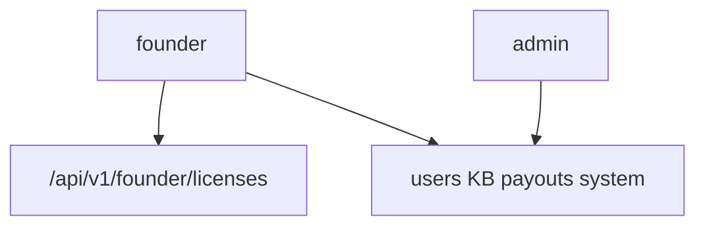

# Kurucu Admin: Lisanslı Kurum + Sahip Yönetimi

Plan durumu: **henüz uygulanmadı** (MVP tasarımı).

## Özet

Yeni `founder` (kurucu) rolü ile lisanslı kurum ve hayvan sahibi yönetimi: liste, detay sayıları, aktif/pasif, yeni kurum oluşturma. Mevcut `admin` operasyonel kalır; lisans API’leri founder’a kilitlenir.

## Kararlar

- **Rol:** Yeni üst rol **`founder`** (kurucu). Lisans / kurum / sahip yönetimi sadece founder’da. Mevcut **`admin`** KB, sistem, radyolog ödemesi, kullanıcı CRUD için kalır.
- **Yetki modeli:** `founder` RBAC’de `*` (admin gibi her şey) + UI’da admin menüsü **ve** Lisanslar. Lisans API’si ayrıca `CAP_FOUNDER` / `require_roles({"founder"})` ile kilitli — normal `admin` lisans oluşturamaz/pasife alamaz.
- **Lisans = kurum kaydı:** `clinic_id` üstüne **LicensedClinic** entity (ad, durum, oluşturulma).
- **Hayvan sahipleri:** `role === 'owner'` ayrı sekme; DICOM = mevcut submission akışı.
- **MVP:** liste + detay metrikleri + aktif/pasif + yeni kurum. Kota / süre / faturalama yok.

## Founder rolü (yeni)

Dokunulacak yerler:

- Backend: `backend/app/auth/rbac.py` (`founder: {*}`), `backend/app/auth/security.py` `JWT_ISSUABLE_ROLES` + seed `founder@demo.local` / `demo1234`, `backend/app/schemas/workflow.py` `ManagedRole`, tenancy’de founder = global (admin gibi)
- Frontend: `src/types.ts` `Role`, `src/lib/auth.ts` SEED, `src/components/Sidebar.tsx`, `src/App.tsx` Gate, Dashboard özeti, i18n `roles.founder*`
- Login demo listesine founder eklenir; Register **founder oluşturamaz** (sadece seed / başka founder)

## Veri modeli

`backend/app/schemas/license.py`:

- `LicensedClinic`: `clinic_id`, `name`, `status` (`active` | `inactive` | `pending`), `created_at`, `updated_at`, `created_by?`
- `LicensedClinicCreate`: `name`, opsiyonel `clinic_id`, opsiyonel ilk `clinic_owner` email/şifre
- `LicensedClinicSummary`: + `staff_count`, `case_count`, `submission_count`
- `OwnerAccountSummary`: email, display_name, active, `pet_count`, `submission_count`, `case_count`

Persistans: `backend/app/services/license_store.py` (memory + SQLite `licensed_clinics`). Seed: `clinic-demo-a` / `clinic-demo-b` aktif.

**Aktif/pasif:**

- Kurum `inactive` → login’de o `clinic_id`’li non-founder/non-admin kullanıcı reddedilir (`owner` clinic’siz kalabilir; clinic_id varsa aynı kural).
- Owner `active=false` → mevcut managed user PATCH + auth sync.

## Backend API

Router `backend/app/api/licenses.py`, **sadece founder**, prefix `/api/v1/founder/licenses`:

| Method | Path | Amaç |
|--------|------|------|
| GET | `/` | Kurum listesi + özet sayılar |
| POST | `/` | Yeni kurum (+ opsiyonel clinic_owner) |
| GET | `/{clinic_id}` | Detay |
| PATCH | `/{clinic_id}` | name / status |
| GET | `/owners` | Owner hesapları + metrikler |
| PATCH | `/owners/{email}` | active toggle |

`LicenseService` sayıları workflow + case store’dan toplar. Wire: container + main.

Testler: `backend/tests/test_founder_licenses.py` — founder OK; admin 403 on license write/list; expert 403; create/list/inactive/owners.

## Frontend

`src/pages/FounderLicenses.tsx` (AdminRadiologists kalıbı):

- Sekme **Lisanslı kurumlar** + **Hayvan sahipleri**
- Rota `lisanslar` / `licenses`, Gate `roles={['founder']}`
- Sidebar: **founder = admin sayfalarının tamamı + Lisanslar**

Client/types/i18n güncellenir. `AdminUsers` admin’de kalır; founder da girebilir (`*` + Gate’e founder eklenir admin rotalarına).

## Uygulama sırası (todos)

1. `founder` rolü (RBAC, JWT, ManagedRole, FE Role, seed, menüler)
2. `LicensedClinic` schema + `license_store` + demo seed clinics
3. `LicenseService` + `/api/v1/founder/licenses` (+ `/owners`) + testler
4. `FounderLicenses` sayfası, routes/sidebar/i18n/backend client

## Bilinçli dışı bırakılanlar

- Kota, süre, lisans anahtarı, Stripe
- Owner’ı zorunlu kuruma bağlama
- Self-service kurum kaydı
- `admin` → `founder` otomatik migrasyon (ayrı seed hesabı)
